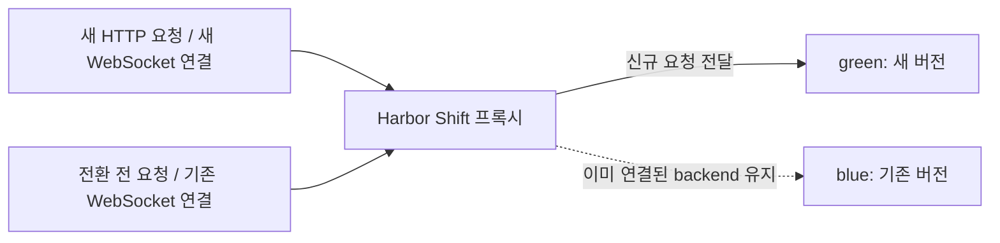
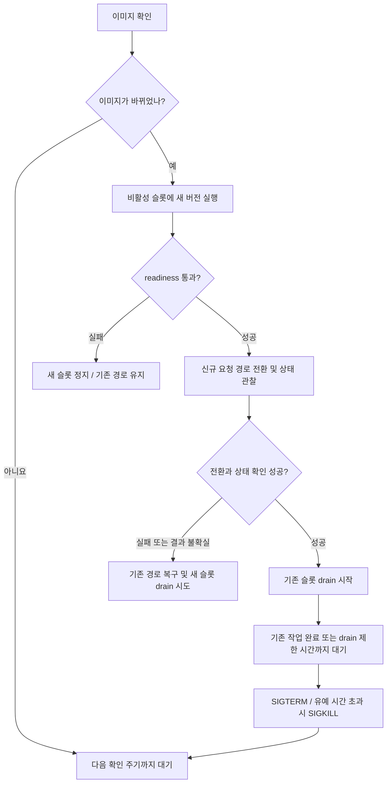
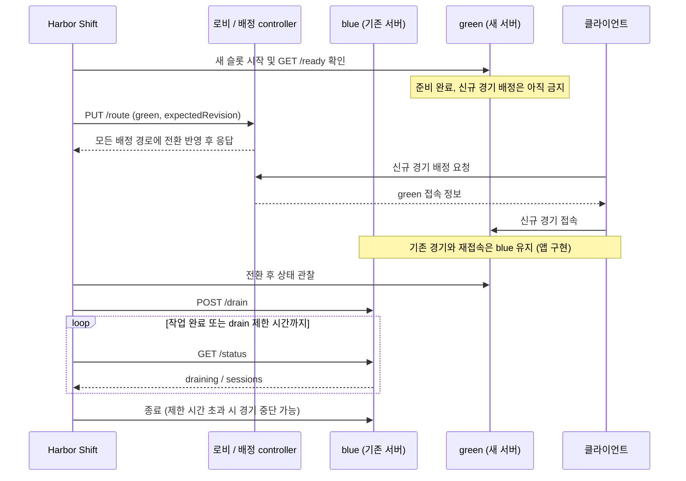

<div align="center">

# Harbor Shift

HTTP/WebSocket 서비스를 위한 Docker blue-green 배포 도구입니다.

[빠른 시작](#빠른-시작) · [동작 방식](#동작-방식) · [환경변수](docs/environment.md) · [종료 설정](#기존-작업이-끝날-때까지-기다리기) · [게임 서버 연동](#게임-서버와-로비에-연동하기)

</div>

Harbor Shift는 설정한 이미지 태그를 주기적으로 확인하고, 이미지가 바뀌면 새 컨테이너를 실행합니다. 준비 상태를 확인한 뒤 신규 요청을 새 컨테이너로 보내고, 기존 요청과 WebSocket 연결은 원래 컨테이너에서 마치도록 기다립니다.

기본 모드는 프록시를 포함하므로 별도의 배포 controller를 구현할 필요가 없습니다. updater 하나가 서비스 하나의 blue/green 슬롯을 관리합니다.

## 빠른 시작

Linux Docker Engine (`linux/amd64`)이 필요합니다. 저장소나 JSON 파일 없이 GHCR 이미지를 받아 실행할 수 있습니다. Docker Compose를 사용할 경우 Compose plugin도 설치하세요.

`main`에 push하면 CI 테스트를 통과한 뒤 `ghcr.io/dev-yunseong/harbor-shift`에 `latest`와 `sha-<전체 commit SHA>` 태그를 게시합니다. 운영에서는 검증한 SHA 태그 또는 digest로 고정할 수 있습니다. [CI](https://github.com/dev-yunseong/harbor-shift/actions/workflows/test.yml)의 게시 완료를 확인하세요. private 패키지는 읽기 권한으로 로그인해야 하며, 익명 pull을 제공하려면 관리자가 패키지를 public으로 설정해야 합니다.

아래 두 방법 중 하나만 선택하세요. 같은 서비스에 updater를 두 개 실행하면 안 됩니다. 예제 앱은 `traefik/whoami:v1.11`이며, 명령은 Linux shell 기준입니다.

### docker run으로 실행하기

처음 한 번 네트워크와 상태 저장 volume을 만드세요. 이미 같은 이름의 리소스가 있으면 용도를 확인한 뒤 재사용하세요.

```sh
docker network create harbor-demo
docker volume create harbor-state
docker pull ghcr.io/dev-yunseong/harbor-shift:latest

docker run -d \
  --name harbor-shift \
  --network harbor-demo \
  --restart=no \
  --stop-timeout 5400 \
  -p 127.0.0.1:8080:8080 \
  --mount type=bind,src=/var/run/docker.sock,dst=/var/run/docker.sock \
  --mount type=volume,src=harbor-state,dst=/state \
  -e HARBOR_ENABLED=true \
  -e HARBOR_GROUP=harbor-web \
  -e HARBOR_IMAGE=traefik/whoami:v1.11 \
  -e HARBOR_NETWORK=harbor-demo \
  -e HARBOR_APP_PORT=80 \
  -e HARBOR_READINESS_PATH=/ \
  -e HARBOR_SHUTDOWN_MODE=docker \
  -e HARBOR_DRAIN_MS=3600000 \
  -e HARBOR_STOP_SECONDS=120 \
  ghcr.io/dev-yunseong/harbor-shift:latest --env --apply

docker logs -f harbor-shift
```

### Docker Compose로 실행하기

아래 내용을 `compose.yaml`로 저장하세요. Compose가 네트워크와 상태 저장 volume을 생성합니다.

```yaml
services:
  harbor-shift:
    image: ghcr.io/dev-yunseong/harbor-shift:latest
    command: ["--env", "--apply"]
    environment:
      HARBOR_ENABLED: "true"
      HARBOR_GROUP: harbor-web
      HARBOR_IMAGE: traefik/whoami:v1.11
      HARBOR_NETWORK: harbor-demo
      HARBOR_APP_PORT: "80"
      HARBOR_READINESS_PATH: /
      HARBOR_SHUTDOWN_MODE: docker
      HARBOR_DRAIN_MS: "3600000"
      HARBOR_STOP_SECONDS: "120"
    ports: ["127.0.0.1:8080:8080"]
    volumes:
      - /var/run/docker.sock:/var/run/docker.sock
      - harbor-state:/state
    networks: [harbor]
    restart: "no"
    stop_grace_period: 90m
networks:
  harbor:
    name: harbor-demo
volumes:
  harbor-state:
```

```sh
docker compose pull
docker compose up -d
docker compose logs -f harbor-shift
```

### 접속 확인과 내 서비스 설정

다른 터미널에서 `curl http://localhost:8080`을 실행하세요. 앱 컨테이너 정보가 나오면 프록시를 통해 접속한 것입니다. 외부에 서비스하려면 앞단에 TLS를 처리하는 reverse proxy를 두세요.

실제 서비스는 처음 실행하기 전에 `HARBOR_IMAGE`, `HARBOR_APP_PORT`, `HARBOR_READINESS_PATH`를 바꾸면 됩니다. 대상 앱의 환경변수는 `HARBOR_APP_ENV_FILE`에 updater 내부의 파일 경로를 지정하고 그 파일을 read-only mount해서 전달할 수 있습니다. updater 환경변수 전체를 앱에 복사하지 않습니다.

위 명령의 이미지 인자는 Harbor Shift 자체이고, `HARBOR_IMAGE`는 교체할 앱 이미지입니다. updater가 앱 슬롯을 생성하므로 같은 앱을 별도 Compose 서비스나 Watchtower로 함께 관리하지 마세요. 임의의 `docker run` 문자열이나 기존 Compose 서비스를 자동으로 가져오는 기능은 아닙니다.

설정은 `--env` 또는 JSON 파일 중 하나를 선택하며 섞어서 덮어쓰지 않습니다. `--apply`를 빼면 설정 검증만 수행합니다. [전체 환경변수](docs/environment.md)

## 동작 방식

아래는 blue에서 green으로 전환한 직후의 연결 상태입니다. 새 HTTP 요청과 새 WebSocket 연결은 green으로 보내고, 전환 전에 시작한 요청과 WebSocket 연결은 blue에서 유지합니다. 다음 배포에서는 두 슬롯의 역할이 바뀝니다.



HTTP keep-alive 연결을 재사용해도 다음 요청은 현재 활성 슬롯으로 보냅니다. 이미 수립된 WebSocket 연결은 종료될 때까지 같은 슬롯에 남습니다.

이미지 변경을 감지하면 다음 순서로 배포합니다. 아래는 기존 슬롯이 실행 중인 경우이며, 최초 실행에서는 blue를 시작하고 readiness를 확인한 뒤 프록시를 엽니다.



그림은 주요 전환 경로를 보여줍니다. 기본 `keep-old` 정책에서 drain 시작 요청이나 완료 확인이 실패하면 기존 프로세스와 journal을 보존합니다. 배포 실패 시 프록시 모드는 업데이트를 멈추고 현재 경로로 계속 서비스합니다. rollback도 실패할 수 있으며, 기존 슬롯의 drain이 시작된 뒤에는 자동 rollback하지 않습니다. [실패 처리와 복구](docs/operations.md)

## JSON 파일로 설정하기

복잡한 hook이나 기존 설정을 유지하려면 아래 내용을 `service.json`으로 저장해서 사용할 수 있습니다. 예제를 이미 실행했다면 기존 슬롯과 상태를 먼저 정리해야 합니다. [종료와 복구 절차](docs/proxy.md#stop-and-recovery)를 참고하세요.

아래 `image`는 설명용 주소입니다. 실제로 pull할 수 있는 이미지로 바꿔야 합니다.

```json
{
  "enabled": true,
  "group": "my-web",
  "image": "example.invalid/team/web:stable",
  "network": "harbor-demo",
  "stateDir": "/state",
  "appPort": 8080,
  "listenPort": 8080,
  "readinessPath": "/health/ready",
  "readinessStatus": 200,
  "memory": "256m",
  "cpus": 1,
  "timing": { "watchMs": 60000, "drainMs": 300000, "stopSeconds": 30 }
}
```

| 설정 | 의미와 확인할 점 |
|---|---|
| `group` | 서비스 고유 이름입니다. `my-web-blue`, `my-web-green` 컨테이너를 생성합니다. |
| `image` | 변경을 감시할 이미지 태그입니다. 해당 태그에 새 이미지를 push하면 다음 확인 주기에 배포합니다. |
| `network` | updater와 앱이 함께 접속할 Docker bridge network입니다. 기본 Compose가 `harbor-demo`를 만듭니다. |
| `stateDir` | 경로와 배포 진행 상태를 저장합니다. 기본 Compose는 `/state`를 전용 named volume에 보존합니다. |
| `appPort` | 앱이 컨테이너 내부에서 수신하는 포트입니다. 호스트에 직접 공개하지 않습니다. |
| `listenPort` | updater 프록시의 내부 포트입니다. 바꾸면 Compose의 포트 매핑도 맞춰야 합니다. |
| `readinessPath` | 새 앱이 요청을 받을 준비가 됐는지 확인할 경로입니다. 지정한 HTTP 상태 코드와 정확히 일치해야 하며 redirect는 실패합니다. |
| `memory`, `cpus` | 각 앱 슬롯의 자원 제한입니다. 전환 중에는 두 슬롯이 동시에 실행됩니다. |
| `watchMs` | 이미지 확인 간격입니다. 예시는 60초입니다. |
| `drainMs` | 기존 작업 종료를 기다릴 최대 시간입니다. 예시는 5분입니다. |
| `stopSeconds` | 종료 시 SIGTERM 이후 SIGKILL까지의 유예 시간입니다. 예시는 30초입니다. |

파일을 `/config/service.json`으로 read-only mount하고 실행 인자를 `/config/service.json --apply`로 지정하세요. Compose에서는 `command: ["/config/service.json", "--apply"]`로 바꿉니다. 이 모드에서는 `HARBOR_*` 설정을 읽지 않습니다. 이후에는 같은 이미지 태그를 갱신하면 updater가 변경을 감지합니다. 설정 파일의 실시간 재로딩은 지원하지 않습니다.

앱 환경변수는 `envFile`로 지정할 수 있습니다. 해당 파일은 updater 내부에서 읽을 수 있도록 별도로 read-only mount해야 합니다. 비공개 registry는 전용 Docker CLI 인증 설정을 read-only mount하는 등 별도의 인증 구성이 필요합니다. 비밀값은 JSON이나 저장소에 넣지 마세요. [전체 설정 설명](docs/proxy.md)

앱 컨테이너를 변경하지 않고 설정만 검사하려면 `--apply` 없이 실행하세요. 이 검사는 실제 이미지 접근이나 서비스 동작을 검증하지 않습니다. Docker socket이나 상태 volume을 연결할 필요도 없습니다.

```sh
docker run --rm \
  --mount "type=bind,src=$(pwd)/service.json,dst=/config/service.json,readonly" \
  ghcr.io/dev-yunseong/harbor-shift:latest /config/service.json
```

CLI는 `--apply`가 없으면 실행 계획만 출력합니다. 제공된 Compose 파일에는 `--apply`가 지정되어 있어 실제 배포가 실행됩니다.

## 기존 작업이 끝날 때까지 기다리기

기본 순서는 **새 슬롯 실행 → readiness 확인 → 신규 요청 전환 → 상태 관찰 → 기존 슬롯 drain → 완료 대기 → 종료**입니다. 기존 WebSocket을 새 컨테이너로 옮기지는 않습니다.

종료 방식은 환경변수로 선택할 수 있습니다. 대기 시간은 고정 sleep이 아니라 **완료 여부를 반복 확인하는 최대 시간**입니다. 빨리 끝나면 곧바로 다음 단계로 진행합니다.

| 설정 | 동작 |
|---|---|
| `HARBOR_SHUTDOWN_MODE=docker` | 기존 프록시 요청과 WebSocket이 끝나기를 기다린 뒤 Docker로 SIGTERM을 보냅니다. |
| `HARBOR_SHUTDOWN_MODE=http` | REST API로 graceful shutdown을 요청하고, 기본적으로 앱 프로세스가 스스로 종료할 때까지 기다립니다. |
| `HARBOR_DRAIN_MS=3600000` | 작업 완료 또는 프로세스 종료를 최대 1시간 기다립니다. |
| `HARBOR_STOP_SECONDS=120` | Docker 종료 시 SIGTERM 이후 최대 2분 기다린 뒤 SIGKILL을 보냅니다. |

위 값은 환경변수 모드의 기본값입니다. 기존 JSON 모드의 기본값(5분 / 30초)은 유지됩니다. 앱이 SIGTERM을 처리하거나 REST 요청을 받아 실제로 작업을 마무리하도록 구현되어 있어야 합니다.

REST 방식은 Compose의 `environment`를 다음처럼 설정합니다. `docker run`에서는 같은 값을 `-e 이름=값`으로 전달하세요.

```yaml
HARBOR_SHUTDOWN_MODE: http
HARBOR_HTTP_PATH: /admin/shutdown
HARBOR_HTTP_METHOD: POST
HARBOR_COMPLETION: exit
HARBOR_DRAIN_MS: "3600000"
HARBOR_STOP_SECONDS: "120"
```

위 API는 요청을 받은 뒤 2xx로 응답하고, 기존 작업을 마친 뒤 프로세스를 종료하는 앱을 가정합니다. **2xx 응답만으로 종료 완료로 판단하지 않습니다.** API가 신규 작업만 막고 프로세스는 계속 실행한다면 다음처럼 상태 API로 완료를 확인하세요.

```yaml
HARBOR_SHUTDOWN_MODE: http
HARBOR_HTTP_PATH: /admin/drain
HARBOR_COMPLETION: http
HARBOR_HTTP_STATUS_PATH: /admin/status
```

상태 API는 `{"draining":true,"sessions":0}` 형태로 응답해야 합니다. 앱 작업 수와 기존 프록시 연결 수가 모두 0일 때 SIGTERM을 보냅니다. 관리 API가 별도 포트에 있다면 `HARBOR_HTTP_URL: "http://{slot}:9090"`을 추가하세요. Authorization이 필요하면 updater의 `HARBOR_HTTP_AUTHORIZATION`에 전체 헤더 값(`Bearer ...`)을 비밀 환경변수로 주입하세요. 값은 설정 파일이나 저장소에 적지 마세요.

REST 요청 실패 시 기본 `HARBOR_ON_FAILURE=keep-old`는 기존 컨테이너를 보존하고 업데이트를 멈춥니다. 정상 요청 후 완료 대기 시간이 초과되면 Docker 종료로 넘어가므로, 경기나 작업의 실제 최대 시간에 맞게 늘리세요. Docker 방식의 연결 수만으로는 백그라운드 작업 완료를 알 수 없습니다. 이런 앱은 REST 상태 확인을 쓰거나 SIGTERM 이후 충분한 유예 시간을 설정해야 합니다.

updater 자체가 먼저 강제 종료되지 않도록 예제는 `--stop-timeout 5400` / `stop_grace_period: 90m`을 사용합니다. 이 값은 앱의 2분 종료 유예와 다른 설정입니다. 작업 대기 시간을 늘리면 updater의 종료 유예도 전체 배포 시간을 감당하도록 늘려야 합니다.

### JSON hook 설정

종료 hook이 없으면 프록시가 기존 HTTP 요청과 WebSocket 연결이 끝나기를 기다린 뒤 SIGTERM을 보냅니다. 앱이 신규 작업 수신을 중단하거나 별도의 정리를 해야 한다면 `service.json`에 `shutdown`을 추가하세요.

예를 들어 이미지에 `/app/drain` 실행 파일이 있고, 이 파일이 신규 작업만 중단하도록 구현되어 있다면 다음과 같이 설정합니다.

```json
"shutdown": {
  "initiate": { "type": "exec", "argv": ["/app/drain"], "timeoutMs": 5000 },
  "completion": { "type": "proxy" },
  "onFailure": "keep-old"
}
```

이 항목은 전체 JSON이 아니라 기존 설정 객체에 추가하는 필드입니다. `/app/drain`은 Harbor Shift가 제공하는 명령이 아니라 앱에서 구현해야 하는 예시입니다.

- 시작 방법은 컨테이너 내부 명령(`exec`), HTTP 요청, 앱 원래 프로세스의 stdin 중에서 고를 수 있습니다.
- `completion: proxy`는 요청과 연결 수만 확인합니다. 백그라운드 작업이나 접속자가 없는 게임도 기다려야 한다면 HTTP 상태 hook 또는 프로세스 종료 대기를 사용하세요.
- 기본 `keep-old` 정책은 drain 시작 요청이 실패하면 기존 프로세스와 journal을 보존하고 배포를 멈춥니다. 이미 전환한 신규 요청은 새 슬롯으로 계속 보냅니다.
- drain이 시작된 뒤 제한 시간을 넘으면 종료를 진행하므로 연결이나 작업이 끊길 수 있습니다. drain 시작 후에는 기존 슬롯으로 자동 rollback하지 않습니다.

[HTTP·stdin 예시와 완료 조건](docs/shutdown.md)

## 게임 서버와 로비에 연동하기

로비가 신규 게임을 배정하고 클라이언트가 슬롯별 주소로 접속하는 구조라면 **custom admission adapter**를 사용할 수 있습니다. 프록시 모드와 달리 배정 controller와 앱 API를 직접 구현해야 합니다.

controller는 `GET /route`와 revision을 이용한 원자적 `PUT /route`를 제공해야 합니다. 각 슬롯은 기본적으로 `GET /ready`, `POST /drain`, `GET /status`를 제공하며, 상태 응답은 연결 수가 아니라 종료를 기다려야 할 전체 작업 수를 반영해야 합니다.

새 서버는 준비가 끝나더라도 전환 전까지 신규 게임을 배정받으면 안 됩니다. 기존 경기와 재접속은 원래 슬롯으로 연결하고, drain 중인 슬롯은 새로운 경기 생성을 거부해야 합니다. 앱이 시작하자마자 자동으로 `ACTIVE` 등록되는 구조라면 별도의 연동 수정이 필요합니다.

아래는 adapter를 구현한 서비스의 배포 예시입니다. Harbor Shift는 배정 대상을 전환하며, 경기 트래픽은 앱이 제공하는 슬롯별 접속 경로를 사용합니다.



이 모드는 최초 blue 슬롯을 수동으로 준비해야 하며, 실행 중인 슬롯이 하나도 없는 장애를 자동 복구하지 않습니다. 기본 포트 공개도 loopback으로 제한됩니다. 기존 배포 스크립트를 교체하기 전에 [adapter 계약과 초기 구성](docs/integration.md)을 확인하세요.

## 운영할 때 알아둘 점

- 기본 프록시는 stateless HTTP/1.1과 WebSocket 서비스용입니다. TLS 종료, 임의 TCP/UDP, 공유 쓰기 볼륨, 기존 Compose 컨테이너 자동 인계는 지원하지 않습니다.
- 앱 배포와 달리 updater 자체를 재시작하면 프록시 연결이 끊깁니다. 무중단이나 proxy HA를 보장하지 않습니다.
- 배포 실패 시 `updates_paused` 로그와 journal을 확인하세요. 상태를 삭제하거나 무조건 재시작하지 마세요. [복구 절차](docs/operations.md)
- `docker compose down`만으로 동적으로 만든 앱 슬롯이 삭제되지는 않습니다. 트래픽을 멈추고 해당 group의 슬롯을 확인한 뒤 정리해야 합니다. [종료 절차](docs/proxy.md#stop-and-recovery)
- 두 버전이 동시에 실행되는 동안 DB 스키마가 호환되어야 합니다. DB migration과 백그라운드 작업 조정은 앱의 책임입니다.
- Docker socket 접근 권한은 호스트 root 권한에 준합니다. updater를 비공개로 유지하고 신뢰하는 이미지만 실행하세요. [보안 안내](SECURITY.md)

Linux/Windows 단위 테스트와 격리된 실제 Docker 환경의 HTTP/WebSocket 배포 테스트를 수행했습니다. 비공개 registry 인증과 운영 앱 호환성은 별도로 검증해야 합니다. [검증 범위](docs/operations.md#validation-status)

[테스트·기여 방법](CONTRIBUTING.md) · [프로젝트 배경](docs/provenance.md) · [MIT 라이선스](LICENSE)
