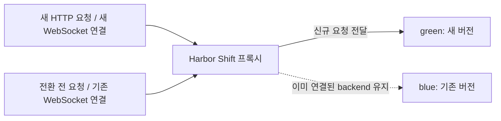
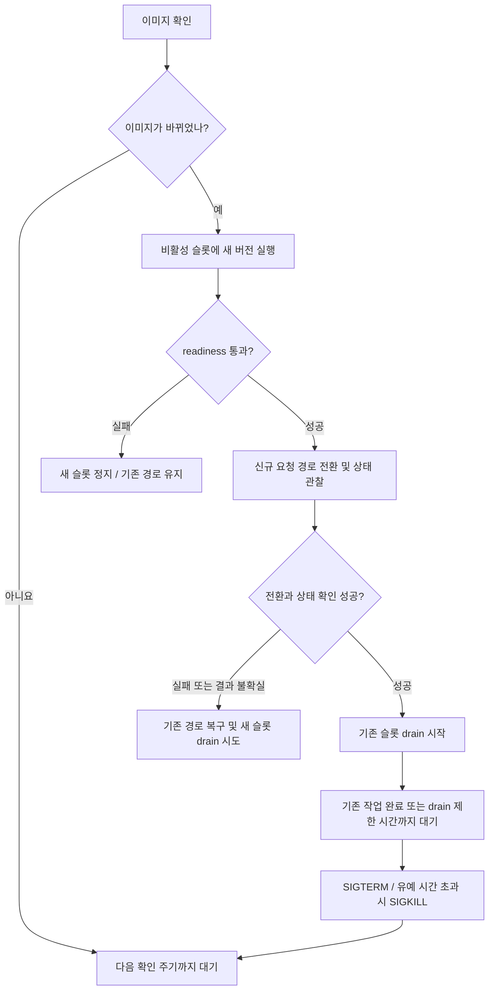
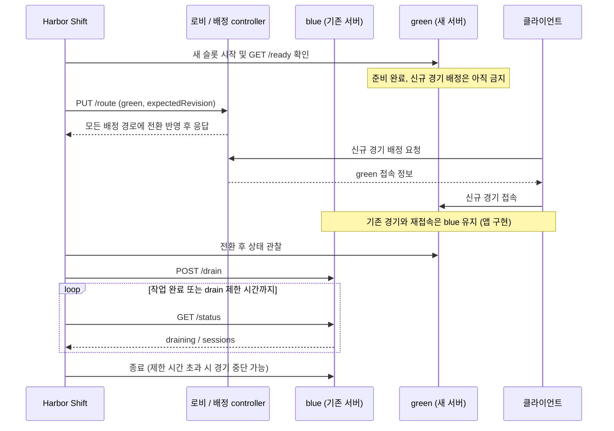

<div align="center">

# Harbor Shift

HTTP/WebSocket 서비스를 위한 Docker blue-green 배포 도구입니다.

[동작 방식](#동작-방식) · [빠른 시작](#빠른-시작) · [서비스 설정](#내-서비스에-적용하기) · [종료 설정](#기존-작업이-끝날-때까지-기다리기) · [게임 서버 연동](#게임-서버와-로비에-연동하기)

</div>

Harbor Shift는 설정한 이미지 태그를 주기적으로 확인하고, 이미지가 바뀌면 새 컨테이너를 실행합니다. 준비 상태를 확인한 뒤 신규 요청을 새 컨테이너로 보내고, 기존 요청과 WebSocket 연결은 원래 컨테이너에서 마치도록 기다립니다.

기본 모드는 프록시를 포함하므로 별도의 배포 controller를 구현할 필요가 없습니다. updater 하나가 서비스 하나의 blue/green 슬롯을 관리합니다.

## 동작 방식

아래는 blue에서 green으로 전환한 직후의 연결 상태입니다. 새 HTTP 요청과 새 WebSocket 연결은 green으로 보내고, 전환 전에 시작한 요청과 WebSocket 연결은 blue에서 유지합니다. 다음 배포에서는 두 슬롯의 역할이 바뀝니다.



HTTP keep-alive 연결을 재사용해도 다음 요청은 현재 활성 슬롯으로 보냅니다. 이미 수립된 WebSocket 연결은 종료될 때까지 같은 슬롯에 남습니다.

이미지 변경을 감지하면 다음 순서로 배포합니다. 아래는 기존 슬롯이 실행 중인 경우이며, 최초 실행에서는 blue를 시작하고 readiness를 확인한 뒤 프록시를 엽니다.



그림은 주요 전환 경로를 보여줍니다. 기본 `keep-old` 정책에서 drain 시작 요청이나 완료 확인이 실패하면 기존 프로세스와 journal을 보존합니다. 배포 실패 시 프록시 모드는 업데이트를 멈추고 현재 경로로 계속 서비스합니다. rollback도 실패할 수 있으며, 기존 슬롯의 drain이 시작된 뒤에는 자동 rollback하지 않습니다. [실패 처리와 복구](docs/operations.md)

## 빠른 시작

Linux Docker Engine과 Docker Compose가 필요합니다. 아래 명령은 예제 웹 서비스를 실행하며, 이미지나 패키지를 외부에 게시하지 않습니다.

```sh
git clone https://github.com/dev-yunseong/harbor-shift.git
cd harbor-shift
docker compose up --build -d
curl http://localhost:8080
docker compose logs -f harbor-shift
```

기본 예제는 `traefik/whoami:v1.11`을 사용합니다. 응답에 컨테이너 정보가 나오면 프록시를 통해 접속한 것입니다. 호스트의 `127.0.0.1:8080`만 공개하므로 외부에 서비스하려면 앞단에 TLS를 처리하는 reverse proxy를 두세요.

updater는 앱 컨테이너를 직접 생성합니다. 같은 앱을 별도 Compose 서비스로 띄우거나 Watchtower로 함께 관리하지 마세요.

## 내 서비스에 적용하기

**처음 시작하기 전에** [`examples/proxy/service.json`](examples/proxy/service.json)을 서비스에 맞게 수정하세요. 예제를 이미 실행했다면 기존 슬롯과 상태를 먼저 정리해야 합니다. [종료와 복구 절차](docs/proxy.md#stop-and-recovery)를 참고하세요.

아래 `image`는 설명용 주소입니다. 실제로 pull할 수 있는 이미지로 바꿔야 합니다.

```json
{
  "enabled": true,
  "group": "my-web",
  "image": "example.invalid/team/web:stable",
  "network": "harbor-demo",
  "stateDir": "/state",
  "appPort": 8080,
  "listenPort": 8080,
  "readinessPath": "/health/ready",
  "readinessStatus": 200,
  "memory": "256m",
  "cpus": 1,
  "timing": { "watchMs": 60000, "drainMs": 300000, "stopSeconds": 30 }
}
```

| 설정 | 의미와 확인할 점 |
|---|---|
| `group` | 서비스 고유 이름입니다. `my-web-blue`, `my-web-green` 컨테이너를 생성합니다. |
| `image` | 변경을 감시할 이미지 태그입니다. 해당 태그에 새 이미지를 push하면 다음 확인 주기에 배포합니다. |
| `network` | updater와 앱이 함께 접속할 Docker bridge network입니다. 기본 Compose가 `harbor-demo`를 만듭니다. |
| `stateDir` | 경로와 배포 진행 상태를 저장합니다. 기본 Compose는 `/state`를 전용 named volume에 보존합니다. |
| `appPort` | 앱이 컨테이너 내부에서 수신하는 포트입니다. 호스트에 직접 공개하지 않습니다. |
| `listenPort` | updater 프록시의 내부 포트입니다. 바꾸면 Compose의 포트 매핑도 맞춰야 합니다. |
| `readinessPath` | 새 앱이 요청을 받을 준비가 됐는지 확인할 경로입니다. 지정한 HTTP 상태 코드와 정확히 일치해야 하며 redirect는 실패합니다. |
| `memory`, `cpus` | 각 앱 슬롯의 자원 제한입니다. 전환 중에는 두 슬롯이 동시에 실행됩니다. |
| `watchMs` | 이미지 확인 간격입니다. 예시는 60초입니다. |
| `drainMs` | 기존 작업 종료를 기다릴 최대 시간입니다. 예시는 5분입니다. |
| `stopSeconds` | 종료 시 SIGTERM 이후 SIGKILL까지의 유예 시간입니다. 예시는 30초입니다. |

설정을 저장하고 빠른 시작의 Compose 명령을 실행하면 됩니다. 이후에는 같은 이미지 태그를 갱신하면 updater가 변경을 감지합니다. 설정 파일의 실시간 재로딩은 지원하지 않습니다.

앱 환경변수는 `envFile`로 지정할 수 있습니다. 해당 파일은 updater 내부에서 읽을 수 있도록 별도로 read-only mount해야 합니다. 비공개 registry는 전용 Docker CLI 인증 설정을 read-only mount하는 등 별도의 인증 구성이 필요합니다. 비밀값은 JSON이나 저장소에 넣지 마세요. [전체 설정 설명](docs/proxy.md)

Node.js 24 이상이 설치되어 있으면 컨테이너를 변경하지 않고 설정을 검사할 수 있습니다. 이 검사는 실제 이미지 접근이나 서비스 동작을 검증하지 않습니다.

```sh
node src/proxy-cli.js examples/proxy/service.json
```

CLI는 `--apply`가 없으면 실행 계획만 출력합니다. 제공된 Compose 파일에는 `--apply`가 지정되어 있어 실제 배포가 실행됩니다.

## 기존 작업이 끝날 때까지 기다리기

기본 순서는 **새 슬롯 실행 → readiness 확인 → 신규 요청 전환 → 상태 관찰 → 기존 슬롯 drain → 완료 대기 → 종료**입니다. 기존 WebSocket을 새 컨테이너로 옮기지는 않습니다.

종료 hook이 없으면 프록시가 기존 HTTP 요청과 WebSocket 연결이 끝나기를 기다린 뒤 SIGTERM을 보냅니다. 앱이 신규 작업 수신을 중단하거나 별도의 정리를 해야 한다면 `service.json`에 `shutdown`을 추가하세요.

예를 들어 이미지에 `/app/drain` 실행 파일이 있고, 이 파일이 신규 작업만 중단하도록 구현되어 있다면 다음과 같이 설정합니다.

```json
"shutdown": {
  "initiate": { "type": "exec", "argv": ["/app/drain"], "timeoutMs": 5000 },
  "completion": { "type": "proxy" },
  "onFailure": "keep-old"
}
```

이 항목은 전체 JSON이 아니라 기존 설정 객체에 추가하는 필드입니다. `/app/drain`은 Harbor Shift가 제공하는 명령이 아니라 앱에서 구현해야 하는 예시입니다.

- 시작 방법은 컨테이너 내부 명령(`exec`), HTTP 요청, 앱 원래 프로세스의 stdin 중에서 고를 수 있습니다.
- `completion: proxy`는 요청과 연결 수만 확인합니다. 백그라운드 작업이나 접속자가 없는 게임도 기다려야 한다면 HTTP 상태 hook 또는 프로세스 종료 대기를 사용하세요.
- 기본 `keep-old` 정책은 drain 시작 요청이 실패하면 기존 프로세스와 journal을 보존하고 배포를 멈춥니다. 이미 전환한 신규 요청은 새 슬롯으로 계속 보냅니다.
- drain이 시작된 뒤 제한 시간을 넘으면 종료를 진행하므로 연결이나 작업이 끊길 수 있습니다. drain 시작 후에는 기존 슬롯으로 자동 rollback하지 않습니다.

[HTTP·stdin 예시와 완료 조건](docs/shutdown.md)

## 게임 서버와 로비에 연동하기

로비가 신규 게임을 배정하고 클라이언트가 슬롯별 주소로 접속하는 구조라면 **custom admission adapter**를 사용할 수 있습니다. 프록시 모드와 달리 배정 controller와 앱 API를 직접 구현해야 합니다.

controller는 `GET /route`와 revision을 이용한 원자적 `PUT /route`를 제공해야 합니다. 각 슬롯은 기본적으로 `GET /ready`, `POST /drain`, `GET /status`를 제공하며, 상태 응답은 연결 수가 아니라 종료를 기다려야 할 전체 작업 수를 반영해야 합니다.

새 서버는 준비가 끝나더라도 전환 전까지 신규 게임을 배정받으면 안 됩니다. 기존 경기와 재접속은 원래 슬롯으로 연결하고, drain 중인 슬롯은 새로운 경기 생성을 거부해야 합니다. 앱이 시작하자마자 자동으로 `ACTIVE` 등록되는 구조라면 별도의 연동 수정이 필요합니다.

아래는 adapter를 구현한 서비스의 배포 예시입니다. Harbor Shift는 배정 대상을 전환하며, 경기 트래픽은 앱이 제공하는 슬롯별 접속 경로를 사용합니다.



이 모드는 최초 blue 슬롯을 수동으로 준비해야 하며, 실행 중인 슬롯이 하나도 없는 장애를 자동 복구하지 않습니다. 기본 포트 공개도 loopback으로 제한됩니다. 기존 배포 스크립트를 교체하기 전에 [adapter 계약과 초기 구성](docs/integration.md)을 확인하세요.

## 운영할 때 알아둘 점

- 기본 프록시는 stateless HTTP/1.1과 WebSocket 서비스용입니다. TLS 종료, 임의 TCP/UDP, 공유 쓰기 볼륨, 기존 Compose 컨테이너 자동 인계는 지원하지 않습니다.
- 앱 배포와 달리 updater 자체를 재시작하면 프록시 연결이 끊깁니다. 무중단이나 proxy HA를 보장하지 않습니다.
- 배포 실패 시 `updates_paused` 로그와 journal을 확인하세요. 상태를 삭제하거나 무조건 재시작하지 마세요. [복구 절차](docs/operations.md)
- `docker compose down`만으로 동적으로 만든 앱 슬롯이 삭제되지는 않습니다. 트래픽을 멈추고 해당 group의 슬롯을 확인한 뒤 정리해야 합니다. [종료 절차](docs/proxy.md#stop-and-recovery)
- 두 버전이 동시에 실행되는 동안 DB 스키마가 호환되어야 합니다. DB migration과 백그라운드 작업 조정은 앱의 책임입니다.
- Docker socket 접근 권한은 호스트 root 권한에 준합니다. updater를 비공개로 유지하고 신뢰하는 이미지만 실행하세요. [보안 안내](SECURITY.md)

Linux/Windows 단위 테스트와 격리된 실제 Docker 환경의 HTTP/WebSocket 배포 테스트를 수행했습니다. 비공개 registry 인증과 운영 앱 호환성은 별도로 검증해야 합니다. [검증 범위](docs/operations.md#validation-status)

[테스트·기여 방법](CONTRIBUTING.md) · [프로젝트 배경](docs/provenance.md) · [MIT 라이선스](LICENSE)
