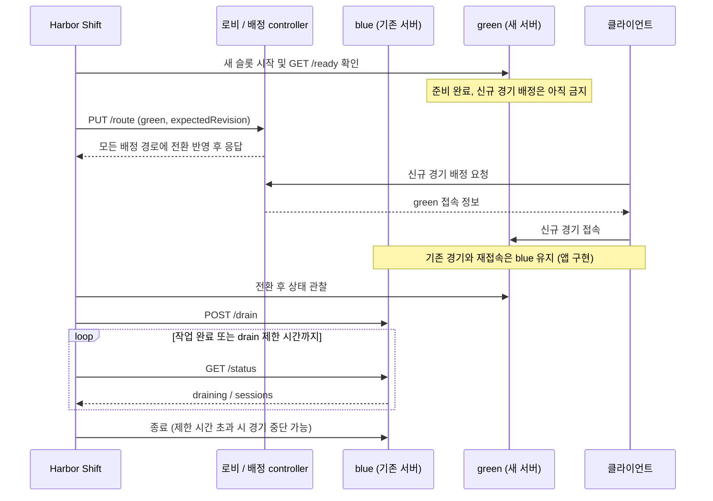

# 게임 서버와 로비 연동

[빠른 시작으로 돌아가기](../README.md#빠른-시작)

로비가 신규 게임을 배정하고 클라이언트가 슬롯별 주소로 접속하는 구조라면 **custom admission adapter**를 사용할 수 있습니다. 프록시 모드와 달리 배정 controller와 앱 API를 직접 구현해야 합니다.

controller는 `GET /route`와 revision을 이용한 원자적 `PUT /route`를 제공해야 합니다. 각 슬롯은 기본적으로 `GET /ready`, `POST /drain`, `GET /status`를 제공하며, 상태 응답은 연결 수가 아니라 종료를 기다려야 할 전체 작업 수를 반영해야 합니다.

새 서버는 준비가 끝나더라도 전환 전까지 신규 게임을 배정받으면 안 됩니다. 기존 경기와 재접속은 원래 슬롯으로 연결하고, drain 중인 슬롯은 새로운 경기 생성을 거부해야 합니다. 앱이 시작하자마자 자동으로 `ACTIVE` 등록되는 구조라면 별도의 연동 수정이 필요합니다.

아래는 adapter를 구현한 서비스의 배포 예시입니다. Harbor Shift는 배정 대상을 전환하며, 경기 트래픽은 앱이 제공하는 슬롯별 접속 경로를 사용합니다.

이 모드는 최초 blue 슬롯을 수동으로 준비해야 하며, 실행 중인 슬롯이 하나도 없는 장애를 자동 복구하지 않습니다. 기본 포트 공개도 loopback으로 제한됩니다. 기존 배포 스크립트를 교체하기 전에 [adapter 계약과 초기 구성](integration.md)을 확인하세요.

[기본 프록시 동작](how-it-works.md) · [adapter API 계약](integration.md)
