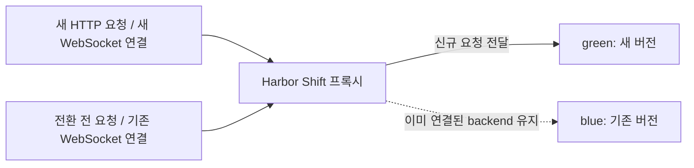
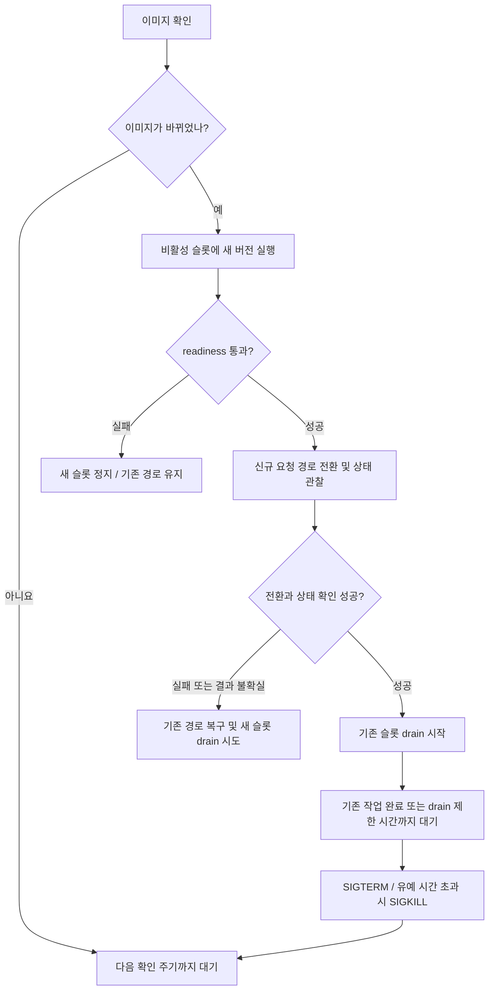

# Blue-green 동작 방식

[빠른 시작으로 돌아가기](../README.md#빠른-시작)

아래는 blue에서 green으로 전환한 직후의 연결 상태입니다. 새 HTTP 요청과 새 WebSocket 연결은 green으로 보내고, 전환 전에 시작한 요청과 WebSocket 연결은 blue에서 유지합니다. 다음 배포에서는 두 슬롯의 역할이 바뀝니다.

HTTP keep-alive 연결을 재사용해도 다음 요청은 현재 활성 슬롯으로 보냅니다. 이미 수립된 WebSocket 연결은 종료될 때까지 같은 슬롯에 남습니다.

이미지 변경을 감지하면 다음 순서로 배포합니다. 아래는 기존 슬롯이 실행 중인 경우이며, 최초 실행에서는 blue를 시작하고 readiness를 확인한 뒤 프록시를 엽니다.

그림은 주요 전환 경로를 보여줍니다. 기본 `keep-old` 정책에서 drain 시작 요청이나 완료 확인이 실패하면 기존 프로세스와 journal을 보존합니다. 배포 실패 시 프록시 모드는 업데이트를 멈추고 현재 경로로 계속 서비스합니다. rollback도 실패할 수 있으며, 기존 슬롯의 drain이 시작된 뒤에는 자동 rollback하지 않습니다. [실패 처리와 복구](operations.md)

[종료 설정](graceful-shutdown.md) · [게임 서버 연동](game-integration.md)
