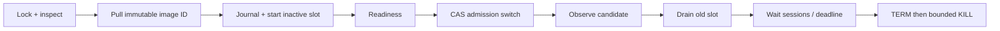

# Lifecycle and recovery

Unchanged images do nothing. Readiness failure stops only the candidate. Switch uncertainty and observation failure attempt to restore old-slot admission, then drain the candidate because it may have accepted sessions. That rollback can itself reach a drain deadline and disconnect candidate sessions. Rollback is traffic recovery, not data rollback.

After old-slot drain begins there is no automatic rollback. Failed drain/status/stop leaves both slots and the journal for an operator; it never guesses which is safe to kill. A failed or timed-out Docker create/start retains the journal because the daemon may finish a request after its CLI exits. Successful completion or completed rollback clears the journal. Stopped containers remain for inspection and are replaced on the next deployment; images are not pruned.

## Interrupted runs

Local exclusive file creation serializes cooperative invocations. Use one local, persistent state directory for the same group/context. Do not place it on NFS, share it across independent hosts, or run external writers/Compose/Watchtower against these containers. Ownership labels prevent accidental adoption, not hostile concurrent modification. The controller CAS prevents stale normal switches but is not a distributed deployment lock.

SIGINT/SIGTERM asks the CLI to finish its current bounded deployment and stops watch polling; it does not interrupt halfway through a switch. A hard kill can leave a lock and journal. Nothing automatically deletes a stale lock or resumes a transaction.

Recovery checklist:

1. Stop all invocations and supervisors; confirm the recorded PID is not still active. Verify the intended Docker context and group.
2. Read `transaction.json` (old/candidate/image/revision), inspect both labeled containers, and read the authoritative controller route. Check delayed Docker operations have finished.
3. Inspect readiness, application drain state, and live sessions on both slots. Decide which healthy, non-draining slot can accept new sessions. Do not reactivate an irreversible drain.
4. Perform a controller CAS update only if needed; verify admission convergence. Retire the other slot through its drain API, wait for sessions, then stop it with a bounded grace. If neither slot is usable, restore from your application runbook.
5. Once exactly one healthy active slot is running and the other is stopped/absent, archive the journal outside the state directory, then remove its journal and stale lock. Run a plan and a supervised single deployment before enabling watch again.

Do not erase state to suppress an error. A damaged/partial journal is also a stop condition. Files are synced before mutations, but directory metadata durability across sudden power loss is filesystem/platform dependent; after host power loss inspect Docker/controller even when the journal is absent.

## Game connections and shared state

Blue-green does not move TCP/WebSocket connections or live game memory. Old sessions continue only while the old process, network and dependencies stay available. Bound drain time means potentially interrupting long sessions. Applications should persist recoverable checkpoints, issue reconnect/resume tokens, and test mixed-version clients/servers. A TCP connection count alone may miss queued tasks or matches without an attached client.

Use backward-compatible expand/contract database changes across the overlap and rollback window. Destructive migrations, single-writer jobs, consumers, and shared mutable files need separate coordination. Provision capacity for two complete instances and measure real readiness and drain behavior under load.

## Validation status

Automated tests cover no-op/dry-run, readiness failure, switch rejection/lost response, health rollback, rollback failure, drain deadline/failure, ownership rejection, serialized invocations, interrupted preparation, filesystem journal/locking, Docker argv construction, and a real loopback HTTP contract fixture. They do not establish Docker engine, production lobby, proxy, TLS, WebSocket, or power-loss correctness.

Before release, run the disposable Docker lab on Linux, exercise real long-lived sessions, test SIGTERM and forced shutdown, and review admission convergence and crash recovery in your integration. No live services were used in initial development.

Docker stop escalation follows the [Docker CLI reference](https://docs.docker.com/reference/cli/docker/container/stop/). Creation flags follow [Docker run documentation](https://docs.docker.com/reference/cli/docker/container/run/).
